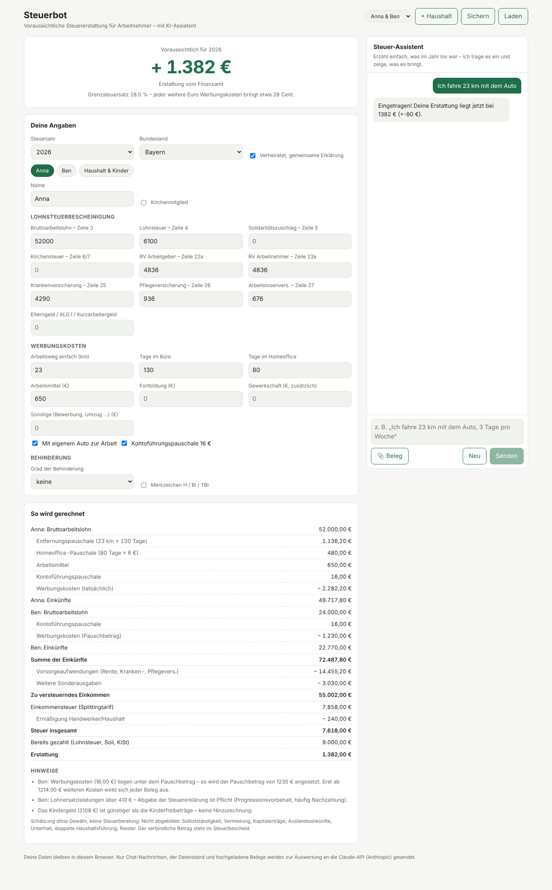

# Steuerbot

Schätzt die voraussichtliche **Einkommensteuer-Erstattung** für Arbeitnehmer:innen in Deutschland – mit einem
**Claude-Assistenten**, der im Gespräch die Angaben sammelt, Belege ausliest und Spartipps gibt.
Gedacht für den privaten Gebrauch in der Familie.



## Was die App kann

- **Erstattungsrechner** für 2025 und 2026 (Grund- und Splittingtarif nach § 32a EStG, Soli, Kirchensteuer)
  - Werbungskosten: Entfernungspauschale (2026: 38 ct ab km 1), Homeoffice-Pauschale, Arbeitsmittel, Fortbildung,
    Gewerkschaft (2026 zusätzlich zum Pauschbetrag), Kontoführung
  - Vorsorgeaufwendungen aus der Lohnsteuerbescheinigung (Rente, Kranken-, Pflege-, Arbeitslosenversicherung)
  - Kinder: Günstigerprüfung Kindergeld ↔ Kinderfreibetrag, Kinderbetreuungskosten, Alleinerziehende
  - Spenden, Krankheitskosten (zumutbare Belastung stufenweise), Behinderten-Pauschbetrag
  - Handwerker und haushaltsnahe Dienstleistungen (§ 35a)
  - Progressionsvorbehalt (Elterngeld, ALG I, Kurzarbeitergeld)
  - Transparente Aufschlüsselung und Hinweise (z. B. „Werbungskosten unter Pauschbetrag“)
- **KI-Assistent (Claude)**: Interview im Chat, trägt Angaben selbst ein, rechnet „Was wäre wenn“ durch
- **Belege auslesen**: Foto oder PDF hochladen (Lohnsteuerbescheinigung, Handwerkerrechnung, Spendenquittung …), Werte
  prüfen und übernehmen
- **Mehrere Haushalte** (z. B. für Eltern, Geschwister), gespeichert im Browser, Export/Import als Datei

## Wichtig: Rechnen tut nie die KI

Die Steuerberechnung steckt im deterministischen Rechenkern (`src/lib/tax/`) und ist durch Tests abgesichert.
Claude ruft ihn nur über Werkzeuge auf (`daten_aktualisieren`, `was_waere_wenn`, `berechnung_anzeigen`) und erklärt
das Ergebnis. So sind die Zahlen reproduzierbar und nicht „halluziniert“.

## Starten

Voraussetzung: Node.js 20+ und ein Claude-API-Schlüssel ([platform.claude.com](https://platform.claude.com)).

```bash
npm install
cp .env.example .env.local    # ANTHROPIC_API_KEY eintragen
npm run dev                   # http://localhost:3000
```

Der Rechner funktioniert auch ohne API-Schlüssel – nur Chat und Belegerkennung brauchen ihn.

Tests: `npm test`

### Für die Familie bereitstellen

Am einfachsten auf Vercel (oder einem eigenen Server mit `npm run build && npm start`). Dabei unbedingt
`STEUERBOT_PASSWORT` setzen – sonst kann jeder mit dem Link über deinen API-Schlüssel chatten.

## Kosten der Claude-Anbindung

Standardmodell ist Claude Opus 5.5 (4 $ / 20 $ pro Mio. Token Ein-/Ausgabe). Ein typisches Gespräch mit 10–20
Nachrichten kostet grob 0,10–0,50 $, ein Beleg wenige Cent. Mit `STEUERBOT_MODEL=claude-sonnet-5-5` wird es etwa halb
so teuer. Prompt-Caching ist aktiviert.

## Datenschutz

- Alle Angaben liegen nur im **localStorage deines Browsers**.
- An die Claude-API (Anthropic) gehen: Chat-Nachrichten, der aktuelle Datenstand (nur Zahlen, keine Steuer-ID/IBAN)
  und hochgeladene Belege. Der Assistent fragt bewusst nicht nach Steuer-ID, Adresse oder Bankdaten.
- Für eine öffentliche App bräuchte es zusätzlich einen Auftragsverarbeitungsvertrag, eine Datenschutzerklärung usw.

## Grenzen (bewusst nicht abgebildet)

Selbstständigkeit/Gewerbe, Vermietung, Kapitalerträge, Auslandseinkünfte, Renten, Unterhalt, doppelte
Haushaltsführung, Riester/Rürup, Verlustvorträge, Arbeitszimmer-Jahrespauschale, Abschreibung von Arbeitsmitteln über
mehrere Jahre. Kirchensteuer bei nur einem kirchenangehörigen Ehepartner wird vereinfacht geschätzt.

**Keine Steuerberatung.** Die App liefert eine Schätzung; der verbindliche Betrag steht im Steuerbescheid. Die
Abgabe erfolgt weiterhin über [Mein ELSTER](https://www.elster.de).

## Neues Steuerjahr hinzufügen

1. In `src/lib/tax/params.ts` einen Block für das Jahr anlegen (Tarifformel § 32a EStG, Soli-Freigrenze,
   Pauschalen, Kinderfreibetrag, Kindergeld).
2. Jahr in `SupportedYear` und im Schema (`src/lib/tax/schema.ts`) ergänzen.
3. Tests in `src/lib/tax/engine.test.ts` erweitern und mit dem
   [BMF-Steuerrechner](https://www.bmf-steuerrechner.de) abgleichen.

## Aufbau

```
src/lib/tax/          Rechenkern (params, tariff, engine, schema) + Tests
src/lib/assistant/    Claude-Anbindung: Werkzeug-Schleife, Belegerkennung, Änderungs-Patches
src/app/api/chat      Chat-Endpunkt (Messages API + Werkzeuge)
src/app/api/beleg     Beleg-Endpunkt (strukturierte Ausgabe)
src/components/       Formular, Ergebnis, Chat
src/middleware.ts     Optionaler Passwortschutz
```
