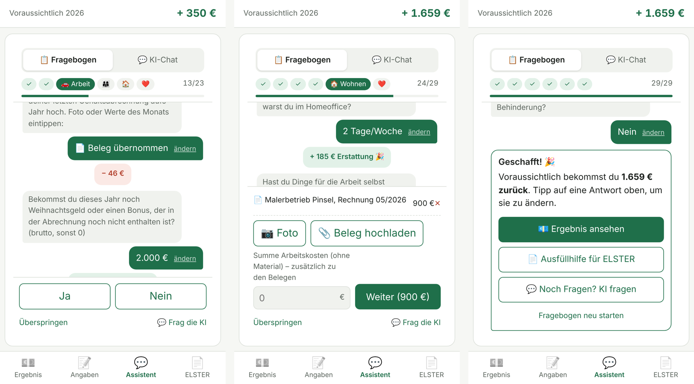
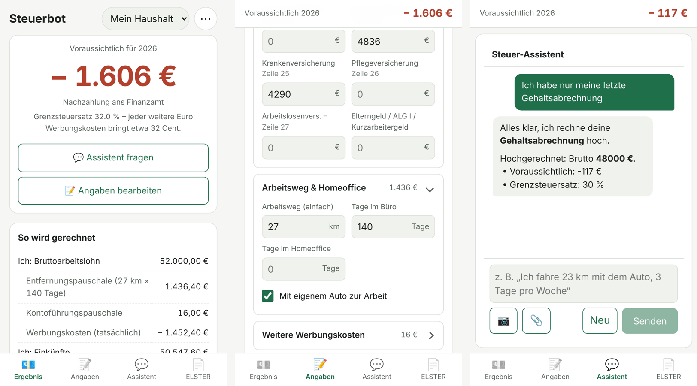
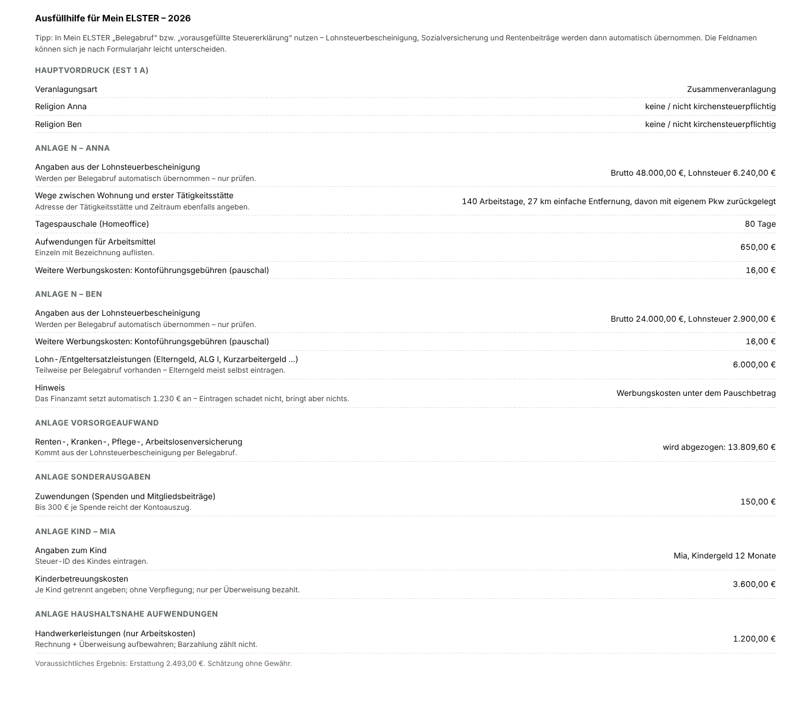

# Steuerbot

Schätzt die voraussichtliche **Einkommensteuer-Erstattung** für Arbeitnehmer:innen in Deutschland – mit einem
**Claude-Assistenten**, der im Gespräch die Angaben sammelt, Belege ausliest und Spartipps gibt.
Gedacht für den privaten Gebrauch in der Familie.


  

## Was die App kann

- **Erstattungsrechner** für 2025 und 2026 (Grund- und Splittingtarif nach § 32a EStG, Soli, Kirchensteuer)
  - Werbungskosten: Entfernungspauschale (2026: 38 ct ab km 1), Homeoffice-Pauschale, Arbeitsmittel, Fortbildung,
    Gewerkschaft (2026 zusätzlich zum Pauschbetrag), Kontoführung
  - Vorsorgeaufwendungen aus der Lohnsteuerbescheinigung (Rente, Kranken-, Pflege-, Arbeitslosenversicherung)
  - Kinder: Günstigerprüfung Kindergeld ↔ Kinderfreibetrag, Kinderbetreuungskosten, Alleinerziehende
  - Spenden, Krankheitskosten (zumutbare Belastung stufenweise), Behinderten-Pauschbetrag
  - Handwerker und haushaltsnahe Dienstleistungen (§ 35a)
  - Progressionsvorbehalt (Elterngeld, ALG I, Kurzarbeitergeld)
  - Transparente Aufschlüsselung und Hinweise (z. B. „Werbungskosten unter Pauschbetrag“)
- **Grenzgänger:innen in die Schweiz** (Wohnsitz Deutschland, tägliche Rückkehr, Art. 15a DBA): Schweizer Lohnausweis
  in CHF (Ziffer 8/9/10/12), Umrechnung mit dem amtlichen Jahreskurs, Anrechnung der Quellensteuer (max. 4,5 %),
  AHV/IV/EO und BVG-Obligatorium wie Rentenversicherung, selbst gezahlte Krankenversicherung (Deutschland oder KVG),
  Vorauszahlungen, Hinweis bei mehr als 60 Nichtrückkehrtagen; Ausfüllhilfe für die Anlage N-Gre
- **Geführter Fragebogen (ohne KI)**: arbeitet die Standardfragen im Chat-Stil ab – Ja/Nein- und Auswahl-Knöpfe,
  Zahlen, Belege hochladen oder Werte eintippen. Fragen, die nicht passen, werden übersprungen (z. B. Kinder, Partner:in).
  Nach jeder Antwort siehst du, wie sich die Erstattung ändert; jede Antwort lässt sich nachträglich ändern.
  Funktioniert komplett ohne API-Schlüssel (dann ohne Beleg-Upload).
- **KI-Assistent (Claude)**: Interview im Chat, trägt Angaben selbst ein, rechnet „Was wäre wenn“ durch
- **Belege auslesen**: Foto oder PDF hochladen (Lohnsteuerbescheinigung, Gehaltsabrechnung, Handwerkerrechnung,
  Spendenquittung …), Werte prüfen und übernehmen
- **Laufendes Jahr ohne Lohnsteuerbescheinigung**: Hochrechnung aus der Gehaltsabrechnung (Monatswerte × 12 oder
  Jahressummen bis zum Abrechnungsmonat, plus erwartetes Weihnachtsgeld/Bonus)
- **Ausfüllhilfe für Mein ELSTER**: welche Angabe in welche Anlage gehört – zum Ausdrucken oder als PDF
- Antworten des Assistenten erscheinen live (Streaming); lange Gespräche werden automatisch neu begonnen, der
  Datenstand bleibt erhalten
- **Fürs Handy gemacht**: untere Navigation (Ergebnis · Angaben · Assistent · ELSTER), Erstattung immer oben
  sichtbar, aufklappbare Abschnitte, Beträge mit Komma, Beleg direkt mit der Kamera fotografieren, als App auf den
  Startbildschirm legbar („Zum Home-Bildschirm“)
- **Sicherer Betrieb**: Anmeldung mit individuellen Konten, gehärteter Docker-Container, TLS-Proxy, Deploy- und
  Update-Skript mit Rollback – orientiert an BSI IT-Grundschutz und TR-02102-2 (siehe [SECURITY.md](SECURITY.md))
- **Mehrere Haushalte** (z. B. für Eltern, Geschwister), gespeichert im Browser, Export/Import als Datei

## Wichtig: Rechnen tut nie die KI

Die Steuerberechnung steckt im deterministischen Rechenkern (`src/lib/tax/`) und ist durch Tests abgesichert.
Claude ruft ihn nur über Werkzeuge auf (`daten_aktualisieren`, `was_waere_wenn`, `gehaltsabrechnung_hochrechnen`,
`berechnung_anzeigen`) und erklärt
das Ergebnis. So sind die Zahlen reproduzierbar und nicht „halluziniert“.

## Starten

Zum Ausprobieren auf dem eigenen Rechner (Entwicklungsmodus, ohne Anmeldung) – Voraussetzung: Node.js 20+.

```bash
npm install
cp .env.example .env.local    # ANTHROPIC_API_KEY eintragen
npm run dev                   # http://localhost:3000
```

Der Rechner funktioniert auch ohne API-Schlüssel – nur Chat und Belegerkennung brauchen ihn.

Prüfen: `npm run check` (Lint, Typprüfung, Tests – läuft auch automatisch auf GitHub und im Docker-Build). Die Tarifwerte sind mit veröffentlichten
Einkommensteuertabellen abgeglichen.

### Auf einem eigenen Server betreiben (Docker, empfohlen)

Voraussetzungen: Linux-Server oder Heimserver (z. B. Raspberry Pi 4/5, Mini-PC, VPS) mit Docker inkl. Compose-Plugin,
git und openssl. Node.js wird auf dem Server **nicht** benötigt. Für eine öffentliche Domain muss sie per DNS auf den
Server zeigen; die Ports 80 und 443 müssen erreichbar sein.

```bash
git clone https://github.com/Creepers1312/steuerbot.git /opt/steuerbot
cd /opt/steuerbot
scripts/deploy.sh            # fragt Domain, TLS (E-Mail oder "internal") und ersten Benutzer ab
```

Der Assistent fragt Schritt für Schritt ab und prüft dabei den Server:

1. **Erreichbarkeit** – im Internet mit eigener Domain, nur im Heimnetz/VPN oder nur lokal (prüft den DNS-Eintrag)
2. **Reverse-Proxy** – erkennt automatisch einen vorhandenen Proxy (Traefik, Nginx Proxy Manager, nginx/Apache/Caddy
   als Container oder Systemdienst) und belegte Ports 80/443:
   | Variante | Wann | Was passiert |
   |---|---|---|
   | mitgelieferter Caddy | kein Proxy vorhanden | Caddy auf 80/443, Zertifikate automatisch (Let's Encrypt oder eigene CA) |
   | Traefik | Traefik läuft schon | App ins Traefik-Netz, Routing per Labels (Entrypoint/Certresolver wählbar) |
   | Host-Port | nginx/Apache/Caddy auf dem Server | App auf `127.0.0.1:<Port>`; fertige Vorlagen in `deploy/generiert/` |
   | Docker-Netz | Proxy-Container, z. B. Nginx Proxy Manager | App ins Netz des Proxys als `http://steuerbot-app:3000`; Anleitung in `deploy/generiert/` |
3. **TLS** – E-Mail für Let's Encrypt oder eigene Zertifikate (nur beim mitgelieferten Caddy)
4. **Anmeldung** – erster Benutzer (Passwort verdeckt), Sitzungsdauer
5. **KI** – an/aus, API-Schlüssel (verdeckt), Modell (Opus oder das günstigere Sonnet)
6. **Automatische Updates** – wöchentlicher Cron-Job mit Rollback; bei aktiver `ufw` optional Ports freigeben

Am Ende steht eine Zusammenfassung; erst nach Bestätigung wird gebaut (Tests laufen mit) und gestartet. Bei
Abbruch bleibt die vorherige Konfiguration unverändert. Später ändern: `scripts/deploy.sh --konfigurieren`.
Für Automatisierung gibt es alle Antworten auch als Optionen (`scripts/deploy.sh --help`).

| Aufgabe | Befehl |
|---|---|
| Benutzer anlegen / Passwort ändern | `scripts/benutzer.sh ben` |
| Benutzer entfernen | `scripts/benutzer.sh ben --entfernen` |
| Aktualisieren (mit automatischem Rollback) | `scripts/update.sh` |
| Konfiguration ändern (Proxy, Domain, KI …) | `scripts/deploy.sh --konfigurieren` |
| Proxy-Vorlagen neu erzeugen | `scripts/proxy-vorlagen.sh` |
| Nur Sicherheitsupdates der Basis-Images | `scripts/update.sh --nur-images` |
| Wöchentlich automatisch aktualisieren | Cron: `17 4 * * 1 /opt/steuerbot/scripts/update.sh --ja` |
| Status / Logs | `docker compose ps` · `docker compose logs -f app` |
| Stoppen | `docker compose down` |

**Heimnetz ohne öffentliche Domain:** `STEUERBOT_DOMAIN=steuerbot.local` (oder die IP) und `STEUERBOT_TLS=internal`.
Caddy erstellt dann eigene Zertifikate; das Stammzertifikat einmal auf den Geräten installieren:
`docker compose exec caddy cat /data/caddy/pki/authorities/local/root.crt > steuerbot-root.crt`.

**Docker-Hub-Limits oder Firmen-Proxy:** in `.env` `BUILD_IMAGE`/`CADDY_IMAGE` auf einen Spiegel setzen bzw.
`HTTPS_PROXY` und `NPM_CA_FILE` angeben (siehe `.env.example`).

**Sicherung:** Steuerdaten liegen in den Browsern, nicht auf dem Server. Zu sichern sind nur `.env` und die
Docker-Volumes `steuerbot_caddy_data`/`steuerbot_caddy_config` (Zertifikate).

Details zu den Sicherheitsmaßnahmen und Restrisiken: [SECURITY.md](SECURITY.md).

Lege in der [Claude-Konsole](https://platform.claude.com) ein monatliches Ausgabenlimit fest, wenn du die KI nutzt.

## Kosten der Claude-Anbindung

Standardmodell ist Claude Opus 5.5 (4 $ / 20 $ pro Mio. Token Ein-/Ausgabe). Ein typisches Gespräch mit 10–20
Nachrichten kostet grob 0,10–0,50 $, ein Beleg wenige Cent. Mit `STEUERBOT_MODEL=claude-sonnet-5-5` wird es etwa halb
so teuer. Prompt-Caching ist aktiviert.

## Datenschutz

- Alle Angaben liegen nur im **localStorage deines Browsers**.
- An die Claude-API (Anthropic) gehen: Chat-Nachrichten, der aktuelle Datenstand (nur Zahlen, keine Steuer-ID/IBAN)
  und hochgeladene Belege. Der Assistent fragt bewusst nicht nach Steuer-ID, Adresse oder Bankdaten.
- Für eine öffentliche App bräuchte es zusätzlich einen Auftragsverarbeitungsvertrag, eine Datenschutzerklärung usw.

## Grenzgänger Schweiz – was genau gerechnet wird

| Thema | Umsetzung |
|---|---|
| Arbeitslohn | Lohnausweis Ziffer 8 × Jahreskurs (2025: 100 CHF = 106,50 €; 2026 vorläufig 1,07 €/CHF, im Formular änderbar), voll in Deutschland steuerpflichtig |
| Quellensteuer | Ziffer 12, angerechnet bis 4,5 % des Bruttolohns; Mehrbetrag → Hinweis auf Rückforderung in der Schweiz |
| AHV/IV/EO | aus Ziffer 9 (5,3 % des Bruttolohns) – wie gesetzliche Rentenversicherung, Arbeitgeberanteil gleich hoch und steuerfrei |
| ALV, NBU | Rest von Ziffer 9 – sonstige Vorsorgeaufwendungen |
| Pensionskasse | Ziffer 10: obligatorischer Teil wie Rentenversicherung, überobligatorischer Teil als sonstige Vorsorge |
| Krankenversicherung | selbst gezahlte Beiträge (Deutschland) oder KVG-Prämie (CHF) als Basisabsicherung; Höchstbetrag sonstige Vorsorge 2.800 € |
| Vorauszahlungen | werden als bereits gezahlt verrechnet – ohne sie ergibt sich meist eine hohe Nachzahlung |

Nicht abgebildet: mehr als 60 Nichtrückkehrtage (dann Freistellung mit Progressionsvorbehalt), steuerpflichtige
überobligatorische Arbeitgeberbeiträge zur Pensionskasse, Kapitalleistungen/Vorbezüge aus der Pensionskasse,
Säule 3a, Homeoffice-Sonderregeln im Sozialversicherungsrecht.

## Grenzen (bewusst nicht abgebildet)

Selbstständigkeit/Gewerbe, Vermietung, Kapitalerträge, Auslandseinkünfte, Renten, Unterhalt, doppelte
Haushaltsführung, Riester/Rürup, Verlustvorträge, Arbeitszimmer-Jahrespauschale, Abschreibung von Arbeitsmitteln über
mehrere Jahre. Kirchensteuer bei nur einem kirchenangehörigen Ehepartner wird vereinfacht geschätzt.

**Keine Steuerberatung.** Die App liefert eine Schätzung; der verbindliche Betrag steht im Steuerbescheid. Die
Abgabe erfolgt weiterhin über [Mein ELSTER](https://www.elster.de).

## Neues Steuerjahr hinzufügen

1. In `src/lib/tax/params.ts` einen Block für das Jahr anlegen (Tarifformel § 32a EStG, Soli-Freigrenze,
   Pauschalen, Kinderfreibetrag, Kindergeld).
2. Jahr in `SupportedYear` und im Schema (`src/lib/tax/schema.ts`) ergänzen.
3. Tests in `src/lib/tax/engine.test.ts` erweitern und mit dem
   [BMF-Steuerrechner](https://www.bmf-steuerrechner.de) abgleichen.

## Aufbau

```
src/lib/tax/          Rechenkern (params, tariff, engine, schema, belegfelder, hochrechnung, ausfuellhilfe) + Tests
src/lib/format.ts     Zahlen und Beträge deutsch lesen/ausgeben
src/lib/useHaushalte.ts  Haushalte im Browser (Zustand, Speichern, Import/Export)
src/lib/interview/    Fragebogen: Fragenkatalog (katalog.ts) und Ablauf + Tests
src/lib/assistant/    Claude-Anbindung: Werkzeug-Schleife, Belegerkennung, Änderungs-Patches
src/app/api/chat      Chat-Endpunkt (Messages API + Werkzeuge, Streaming per Server-Sent Events)
src/app/api/beleg     Beleg-Endpunkt (strukturierte Ausgabe)
src/components/       Formular, Ergebnis, Chat
src/middleware.ts     Anmeldung, CSP-Nonce, CSRF-Schutz
src/lib/sicherheit/   Sitzungen, Passwort-Hashes, Rate-Limits, Anfrageprüfung + Tests
scripts/              deploy.sh, update.sh, benutzer.sh, passwort-hash.mjs
deploy/               Caddyfile (TLS), Healthcheck
Dockerfile, docker-compose.yml
```

## Fragen im Fragebogen anpassen

Alle Fragen stehen in `src/lib/interview/katalog.ts`. Jede Frage hat einen Text, optional eine Bedingung (`wenn`),
eine Erklärung („Was heißt das?“) und eine Funktion, die die Antwort in den Datenstand schreibt. Neue Fragen einfügen,
Texte ändern oder die Reihenfolge anpassen geht dort ohne weitere Änderungen; `npm test` prüft den Ablauf.
